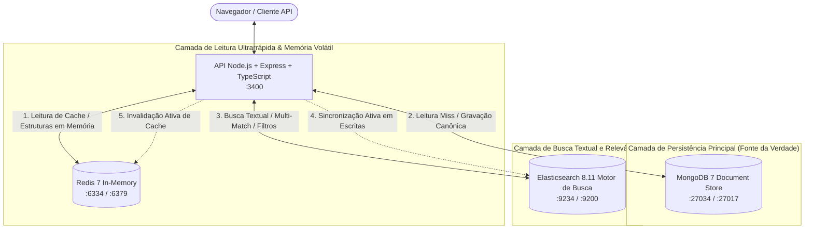
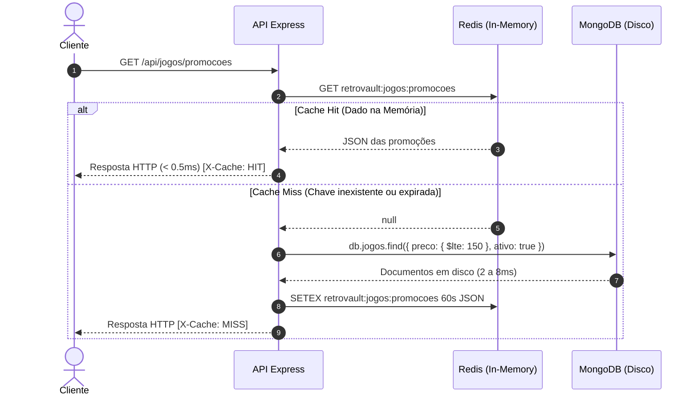
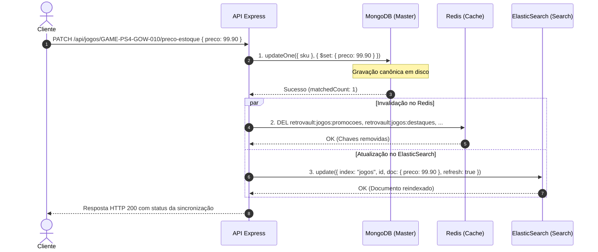

# Checkpoint 2: Arquitetura com Múltiplos Bancos NoSQL (RetroVault)

**Universidade Tecnológica Federal do Paraná — UTFPR, Câmpus Guarapuava**  
**Curso:** Tecnologia em Sistemas para Internet (TSI34E-TSI4)  
**Disciplina:** Banco de Dados NoSQL · **Professor:** Prof. Marcelo Marcos Vichar Junior  
**Projeto:** RetroVault — E-commerce & Preservação Histórica de Mídias Físicas de Jogos  

---

## Seção 1 — Arquitetura e Fonte da Verdade

### 1.1 Diagrama de Arquitetura Multibanco
O **RetroVault** adota o padrão de **Persistência Poliglota** (*Polyglot Persistence*), onde cada banco de dados NoSQL é empregado exclusivamente para o propósito no qual é especialista:
* **MongoDB (Armazenamento Principal):** Document Store transacional e fonte única da verdade para catálogos, pedidos, clientes e categorias.
* **Redis (Memória RAM Ultrarrápida):** Cache-aside de baixa latência ($< 0.5\text{ ms}$), contadores atômicos e estruturas de dados voláteis em memória (carrinho de compras, esteira postal, conjuntos de plataformas e placar de vendas).
* **Elasticsearch (Motor de Busca Textual):** Índice invertido com analisador fonético/morfológico em português brasileiro (`texto_ptbr`), busca com pesos (`multi_match`), tolerância a erros tipográficos (*fuzziness*) e filtros exatos combinados via `bool filter`.



---

### 1.2 Matriz de Dados, Fonte da Verdade e Justificativa de Réplicas

| Tipo de Dado | Fonte da Verdade (Gravação Primária) | Outros Bancos com Cópia | Justificativa Técnica da Réplica |
| :--- | :--- | :--- | :--- |
| **Catálogo de Mídias Físicas (`jogos`)** | **MongoDB** (coleção `jogos`) | **Redis** (chaves de cache) e **Elasticsearch** (índice `jogos`) | O MongoDB garante persistência ACID por documento. O Redis armazena o JSON pronto de listas quentes (`promocoes`, `destaques`, item por `sku`) para resposta em $< 0.5\text{ ms}$. O Elasticsearch mantém o índice invertido para permitir buscas textuais inteligentes em títulos, descrições e tags com pesos e tolerância a erros de digitação. |
| **Categorias de Consoles e Gêneros** | **MongoDB** (coleção `categorias`) | **Redis** (`retrovault:categorias:todas` e `retrovault:consoles:ativos`) | No MongoDB ficam os metadados cadastrais. No Redis, o cache de 300s agiliza a montagem da barra de navegação global, e um `Set` nativo permite verificações instantâneas de pertinência $O(1)$. |
| **Pedidos de Compra e Expedição** | **MongoDB** (coleção `pedidos`) | **Redis** (lista `retrovault:expedicao:pedidos`) | No MongoDB o pedido é imutável para fins contábeis e fiscais. No Redis, o identificador do pedido entra em uma fila FIFO (`List`) em memória para controle ágil da esteira de despacho postal sem I/O de disco. |
| **Carrinho de Compras do Cliente** | **Redis** (hash `retrovault:carrinho:<id>`) | *Nenhum* (persistência temporária com TTL de 24h) | O carrinho de compras tem ciclo de vida altamente volátil. O Redis (`Hash`) permite incrementar quantidades de itens e recalcular subtotais atomicamente via `HINCRBY` em submilissegundos, só gravando no MongoDB quando o pedido for de fato finalizado (*checkout*). |
| **Contadores de Popularidade & Visualizações** | **Redis** (string `retrovault:views:<sku>`) | *Nenhum* (ou sincronização batch assíncrona) | Cada clique no produto gera um `INCR` atômico em memória RAM no Redis, evitando sobrecarga de escrita em disco no MongoDB por `updateOne({ $inc })`. |
| **Ranking dos Jogos Mais Vendidos** | **Redis** (sorted set `retrovault:ranking:jogos:vendidos`) | **MongoDB** (histórico consolidado em `pedidos`) | Manter o placar no Redis (`Sorted Set`) viabiliza consultas de Top N em $O(\log N)$ em tempo real, sem a necessidade de comandos pesados de agregação (`$group`, `$sort`) no MongoDB. |

---

## Seção 2 — Redis como Cache

### 2.1 Implementação do Padrão Cache-Aside
Nas rotas de leitura crítica do RetroVault (como vitrines de promoções e destaques), adotamos o padrão **Cache-Aside** (*Lazy Loading*):
1. A aplicação intercepta a requisição e verifica se o dado existe na memória RAM do Redis via `cacheGet(key)`.
2. **Cache Hit:** O dado pronto é retornado imediatamente em fração de milissegundo ($< 0.5\text{ ms}$) com o cabeçalho HTTP `X-Cache: HIT`.
3. **Cache Miss:** A aplicação consulta a coleção no MongoDB em disco, grava o resultado no Redis com um **TTL** pré-definido via `cacheSet(key, dados, ttl)` e entrega a resposta com `X-Cache: MISS`.



### 2.2 Rotas Mapeadas, Chaves e Políticas de TTL

| Rota / Endpoint | Chave no Redis | TTL (segundos) | Justificativa do TTL | Momento da Invalidação Ativa |
| :--- | :--- | :---: | :--- | :--- |
| `GET /api/jogos/promocoes` | `retrovault:jogos:promocoes` | **60s** | Mídias físicas raras possuem estoques unitários ou reduzidos. 60 segundos assegura alta taxa de reuso da memória sem risco de exibir itens já esgotados. | Invalidado imediatamente (`cacheDelMany`) quando qualquer jogo sofre alteração de preço/estoque (`PATCH /:sku/preco-estoque`) ou quando uma nova mídia é cadastrada (`POST /api/jogos`). |
| `GET /api/jogos/destaques` | `retrovault:jogos:destaques` | **120s** | A vitrine principal da Home exibe os títulos com notas $\ge 4.5$. Como as avaliações de curadoria variam lentamente, 2 minutos de TTL preservam o banco principal. | Invalidado na alteração de status/dados do jogo ou via purga manual (`DELETE /api/jogos/cache`). |
| `GET /api/categorias` | `retrovault:categorias:todas` | **300s** | Categorias de videogames e consoles são praticamente estáticas, permitindo TTL de 5 minutos. | Invalidado apenas em manutenções ou mutações no catálogo de categorias. |
| `GET /api/jogos/:sku` | `retrovault:jogos:sku:<sku>` | **60s** | Cache individual da página de detalhes do produto. Permite navegação ultrarrápida entre abas. | Invalidado na alteração direta do próprio SKU (`retrovault:jogos:sku:<sku>`). |

---

## Seção 3 — Redis como Estrutura de Dados

No RetroVault, o Redis vai além do cache tradicional de strings/JSONs, operando com quatro estruturas nativas aplicadas a necessidades reais do negócio. Todas as chaves seguem rigorosamente o padrão canônico **`retrovault:<entidade>:<identificador>`**:

### 3.1 Hash: Carrinho de Compras em Memória (`retrovault:carrinho:<cliente_id>`)
* **Caso de Uso:** Gerenciamento do carrinho de compras ativo antes do checkout.
* **Justificativa:** Evita serializar e desserializar um documento JSON inteiro a cada clique. Permite ler, atualizar campos isolados e somar contadores atomicamente com complexidade $O(1)$.
* **Comandos Utilizados:**
  * `HSET retrovault:carrinho:<id>`: Cria ou define propriedades (`cliente_nome`, `status`, `valor_total`).
  * `HINCRBY retrovault:carrinho:<id> total_itens <qtd>`: Incrementa atomicamente a quantidade de itens no carrinho.
  * `HGETALL retrovault:carrinho:<id>`: Recupera o carrinho completo estruturado.
* **Rotas da API:** `POST /api/redis/carrinho/:cliente_id`, `PATCH /api/redis/carrinho/:cliente_id/adicionar-item`, `GET /api/redis/carrinho/:cliente_id`.

### 3.2 List: Fila de Expedição Postal FIFO (`retrovault:expedicao:pedidos`)
* **Caso de Uso:** Esteira de empacotamento e despacho de mídias físicas pelos Correios / transportadora.
* **Justificativa:** Listas duplamente encadeadas no Redis operam em $O(1)$ nas pontas. A entrada no final e saída no início garantem que o primeiro pedido pago seja o primeiro a ser postado (*First In, First Out*).
* **Comandos Utilizados:**
  * `RPUSH retrovault:expedicao:pedidos <payload_json>`: Insere o pedido no final da esteira.
  * `LRANGE retrovault:expedicao:pedidos 0 -1`: Visualiza a fila de espera sem remover itens.
  * `LPOP retrovault:expedicao:pedidos`: O operador de expedição consome o próximo pacote para etiquetagem.
* **Rotas da API:** `POST /api/redis/expedicao/pedidos`, `GET /api/redis/expedicao/pedidos`, `POST /api/redis/expedicao/atender`.

### 3.3 Set: Consoles e Plataformas Suportadas (`retrovault:consoles:ativos`)
* **Caso de Uso:** Conjunto de plataformas e consoles aceitos no e-commerce para validação de mídias.
* **Justificativa:** O Set assegura matematicamente a unicidade dos elementos (elimina duplicatas na inserção) e oferece teste de pertinência em tempo constante $O(1)$.
* **Comandos Utilizados:**
  * `SADD retrovault:consoles:ativos "PS2" "SNES" "N64"`: Adiciona consoles ignorando repetições.
  * `SMEMBERS retrovault:consoles:ativos`: Lista todas as plataformas ativas.
  * `SISMEMBER retrovault:consoles:ativos "PS2"`: Validação booleana instantânea de suporte.
* **Rotas da API:** `POST /api/redis/consoles`, `GET /api/redis/consoles`, `GET /api/redis/consoles/verificar?console=...`.

### 3.4 Sorted Set: Placar de Jogos Mais Vendidos (`retrovault:ranking:jogos:vendidos`)
* **Caso de Uso:** Leaderboard em tempo real dos jogos mais vendidos da história da loja.
* **Justificativa:** Cada membro possui uma pontuação associada (*score*). O Redis mantém a coleção permanentemente indexada por uma Skip List ($O(\log N)$), viabilizando obter o Top N instantaneamente sem necessidade de `GROUP BY` e `ORDER BY` em disco.
* **Comandos Utilizados:**
  * `ZINCRBY retrovault:ranking:jogos:vendidos <qtd> "<nome_jogo>"`: Soma as cópias vendidas ao score.
  * `ZREVRANGE retrovault:ranking:jogos:vendidos 0 <limite-1> WITHSCORES`: Retorna o ranking decrescente com pontuação.
* **Rotas da API:** `POST /api/redis/ranking/venda`, `GET /api/redis/ranking/top?limite=...`.

---

## Seção 4 — ElasticSearch: Mapping e Indexação

### 4.1 O Mapping do Índice `jogos` (`init/elastic-init.json`)
O arquivo declarativo de infraestrutura `init/elastic-init.json` define as configurações físicas e o esquema de tipos do índice, configurado sem parâmetros obsoletos (`boost` no mapping foi totalmente banido no ElasticSearch 8):

```json
{
  "settings": {
    "number_of_shards": 1,
    "number_of_replicas": 0,
    "analysis": {
      "filter": {
        "portuguese_stop": {
          "type": "stop",
          "stopwords": "_portuguese_"
        },
        "portuguese_stemmer": {
          "type": "stemmer",
          "language": "portuguese"
        }
      },
      "analyzer": {
        "texto_ptbr": {
          "tokenizer": "standard",
          "filter": [
            "lowercase",
            "asciifolding",
            "portuguese_stop",
            "portuguese_stemmer"
          ]
        }
      }
    }
  },
  "mappings": {
    "properties": {
      "jogo_id": { "type": "keyword" },
      "sku": { "type": "keyword" },
      "titulo": { "type": "text", "analyzer": "texto_ptbr" },
      "descricao": { "type": "text", "analyzer": "texto_ptbr" },
      "plataforma": { "type": "keyword" },
      "categoria": { "type": "keyword" },
      "preco": { "type": "float" },
      "quantidade_estoque": { "type": "integer" },
      "tags": { "type": "text", "analyzer": "texto_ptbr" },
      "condicao": { "type": "keyword" },
      "ano_lancamento": { "type": "integer" },
      "ativo": { "type": "boolean" },
      "media_nota": { "type": "float" }
    }
  }
}
```

### 4.2 Justificativa da Escolha entre `text` e `keyword`

* **Campos do tipo `text` (`titulo`, `descricao`, `tags`):**
  * *Comportamento:* Passam pelo analisador morfológico `texto_ptbr`. O texto é quebrado em tokens individuais, convertido para minúsculas, desprovido de acentuações (`asciifolding`), limpo de stopwords em português (`de`, `e`, `com`) e reduzido à sua raiz léxica (*stemming*).
  * *Justificativa:* Permite que buscas como `"pizzas"`, `"aventuras"` ou `"historias"` casem com termos como `"pizza"`, `"aventura"` e `"história"`.
* **Campos do tipo `keyword` (`jogo_id`, `sku`, `plataforma`, `categoria`, `condicao`):**
  * *Comportamento:* O valor não é analisado nem fragmentado; é indexado exatamente como uma cadeia única e indivisível.
  * *Justificativa:* São utilizados para correspondência exata, filtros determinísticos, agregações e ordenações (ex: filtrar exatamente por `plataforma: "Nintendo 64"` ou `condicao: "Lacre de Fábrica"`).
* **Campos Numéricos e Booleanos (`preco`, `quantidade_estoque`, `ativo`, `media_nota`):**
  * *Justificativa:* Indexados em estruturas de B-Tree (BKD-Tree) otimizadas para consultas de intervalo (*range queries*, ex: `preco <= 150.00`).

### 4.3 Pipeline ETL: Do MongoDB para o Índice Invertido
O script declarativo `app/src/scripts/seed-elastic.ts` (executado automaticamente pelo `iniciar.sh` e pela rota `POST /api/busca/reindexar`) realiza a sincronização inicial:
1. Conecta simultaneamente ao MongoDB e ao ElasticSearch.
2. Lê o arquivo declarativo `init/elastic-init.json` e cria o índice `jogos` com as definições do analisador `texto_ptbr`.
3. Realiza a leitura de todos os documentos das coleções `jogos` e `categorias` no MongoDB.
4. Mapeia os identificadores relacionais (`categoria_id` $\rightarrow$ `categoria.nome`).
5. Envia cada jogo individualmente para o ElasticSearch utilizando a chave primária `_id` do MongoDB como ID do documento indexado.
6. Força a atualização do índice (`indices.refresh`), disponibilizando os 20 títulos imediatamente para buscas.

---

## Seção 5 — ElasticSearch: Busca Textual

A API disponibiliza endpoints com diferentes níveis de sofisticação em `app/src/controllers/busca.controller.ts`:

### 5.1 Busca Completa Multi-Campo com Pesos e Fuzziness (`GET /api/busca?q=...`)
A busca principal do e-commerce utiliza a query `multi_match` combinando múltiplos campos, pesos diferenciados e tolerância a erros de digitação:

```json
{
  "query": {
    "multi_match": {
      "query": "zeldda",
      "fields": ["titulo^3", "descricao^2", "tags"],
      "fuzziness": "AUTO",
      "prefix_length": 1
    }
  }
}
```

* **Justificativa dos Pesos (*Field Boosting*):**
  * `titulo^3` (Peso 3): É o atributo mais relevante para o usuário. Se a palavra buscada estiver no título do jogo (ex: *"The Legend of Zelda"*), esse resultado recebe pontuação tripla e aparece no topo.
  * `descricao^2` (Peso 2): A descrição traz detalhes da trama e contexto histórico. Tem relevância intermediária.
  * `tags` (Peso 1 - base): Palavras-chave adicionais (ex: *"n64 rpg aventura goty"*). Servem como critério de desempate e completude.
* **Tolerância a Erro de Digitação (`fuzziness: "AUTO"`):**
  * Baseado na distância de Levenshtein. Termos com pequenas trocas, omissões ou adições de letras (ex: `zeldda` $\rightarrow$ `Zelda`, `piza` $\rightarrow$ `Pizza`, `calabreza` $\rightarrow$ `Calabresa`) são encontrados com sucesso.

### 5.2 Busca com Filtros Exatos (`GET /api/busca/filtrada?q=...&plataforma=...&preco_max=...`)
A rota de busca avançada implementa a estrutura `bool` do ElasticSearch, separando a pontuação de relevância (`must`) dos filtros determinísticos de alto desempenho (`filter`):

```json
{
  "query": {
    "bool": {
      "must": {
        "multi_match": {
          "query": "zelda",
          "fields": ["titulo^3", "descricao^2", "tags"],
          "fuzziness": "AUTO"
        }
      },
      "filter": [
        { "term": { "ativo": true } },
        { "term": { "plataforma": "Nintendo 64" } },
        { "range": { "preco": { "lte": 400.00 } } }
      ]
    }
  }
}
```
> **Vantagem de Performance:** As cláusulas em `filter` não participam do cálculo do `_score` e são cacheadas em memória pelo ElasticSearch em estruturas de *bitsets*, garantindo resposta instantânea mesmo com milhões de registros.

---

## Seção 6 — Integração e Sincronização

A rota oficial de mutação `PATCH /api/jogos/:sku/preco-estoque` e a de cadastro `POST /api/jogos` implementam a orquestração transacional entre os três bancos:



### 6.1 Respostas Técnicas Obrigatórias

#### Pergunta 1: Depois de uma alteração, em quanto tempo a busca e o cache passam a mostrar o dado novo?
* **No Cache (Redis):** A exibição do dado novo é **imediata (0 segundos)** na próxima requisição. A rota de escrita invoca `cacheDelMany()`, que expurga atômica e instantaneamente as chaves do Redis. Quando o próximo cliente requisita a rota de promoções ou detalhes, a aplicação sofre um `Cache Miss` inevitável e busca o dado atualizado diretamente do MongoDB, repovoando a memória RAM em seguida.
* **Na Busca Textual (ElasticSearch):** A sincronização é **imediata para o usuário** porque a API executa a chamada `elastic.update()` com o parâmetro `refresh: true`. Esse parâmetro força o ElasticSearch a abrir um novo *Searcher Lucene* instantaneamente, tornando o preço/estoque atualizado visível para buscas no mesmo milissegundo em que a requisição de escrita retorna.

#### Pergunta 2: O que acontece se a gravação no MongoDB der certo e a atualização do ElasticSearch falhar?
* **Comportamento Atual no Código:**
  Como o MongoDB é a **Fonte Canônica da Verdade**, se a mutação no MongoDB tiver sucesso mas o ElasticSearch estiver instável ou offline, a operação não cancela a escrita principal. O bloco `try/catch` no controller captura a exceção do ElasticSearch, registra o log de erro no servidor e devolve ao cliente uma resposta informando `elasticsearch: "FALHA_NA_SINCRONIZACAO"`. O cache do Redis ainda é invalidado, garantindo que as páginas de carrinho, checkout e consultas diretas mostrem o preço correto.
* **Estratégias de Mitigação e Consistência Eventual para Produção:**
  1. **Outbox Pattern com Fila Assíncrona:** A gravação no MongoDB grava um evento em uma coleção de eventos pendentes (`outbox`). Um worker em segundo plano lê essa fila e reexecuta a indexação no ElasticSearch com política de tentativas exponenciais (*exponential backoff*).
  2. **Job de Conciliação / Reindexação Periódica:** O endpoint `POST /api/busca/reindexar` ou um cron agendado reindexa periodicamente documentos divergentes comparando o campo `data_atualizacao` entre o MongoDB e o ElasticSearch.

---

## Seção 7 — Roteiro de Demonstração

Todos os comandos abaixo foram validados diretamente na aplicação em execução na porta `3400`:

---

### Teste 1: Cache-Aside no Redis — Latência e Invalidação

#### 1.1 Primeira chamada (Cache Miss — Leitura do MongoDB em disco)
```bash
curl -s http://localhost:3400/api/jogos/promocoes | jq '{origem, tempo_resposta, total_itens}'
```
**Saída obtida:**
```json
{
  "origem": "MONGODB (CACHE MISS)",
  "tempo_resposta": "3.40 ms",
  "total_itens": 8
}
```

#### 1.2 Segunda chamada imediata (Cache Hit — Servido da Memória RAM em $< 0.5\text{ ms}$)
```bash
curl -s http://localhost:3400/api/jogos/promocoes | jq '{origem, tempo_resposta, total_itens}'
```
**Saída obtida:**
```json
{
  "origem": "REDIS (CACHE HIT)",
  "tempo_resposta": "0.35 ms",
  "total_itens": 8
}
```

---

### Teste 2: Estruturas de Dados Nativas no Redis

#### 2.1 Hash: Carrinho de Compras em Memória (`HSET`, `HINCRBY`, `HGETALL`)
```bash
# 1. Abrir carrinho
curl -s -X POST http://localhost:3400/api/redis/carrinho/cli-001 \
  -H "Content-Type: application/json" \
  -d '{"cliente_nome": "Lucas Rosas", "status": "aberto", "total_itens": 0, "valor_total": "0.00"}' | jq '{estrutura, chave, carrinho}'

# 2. Adicionar jogo e incrementar contador atomicamente
curl -s -X PATCH http://localhost:3400/api/redis/carrinho/cli-001/adicionar-item \
  -H "Content-Type: application/json" \
  -d '{"titulo": "The Last of Us Part I", "quantidade": 1, "preco": 249.90}' | jq '{estrutura, item_adicionado, total_itens, valor_total}'

# 3. Consultar dados estruturados do carrinho
curl -s http://localhost:3400/api/redis/carrinho/cli-001 | jq '{estrutura, carrinho}'
```
**Saída obtida:**
```json
{
  "estrutura": "HASH (HGETALL)",
  "carrinho": {
    "cliente_id": "cli-001",
    "cliente_nome": "Lucas Rosas",
    "status": "aberto",
    "total_itens": "1",
    "valor_total": "249.90",
    "ultimo_item_adicionado": "The Last of Us Part I"
  }
}
```

#### 2.2 List: Esteira de Expedição Postal FIFO (`RPUSH`, `LRANGE`, `LPOP`)
```bash
# 1. Enfileirar dois pedidos pagos
curl -s -X POST http://localhost:3400/api/redis/expedicao/pedidos -H "Content-Type: application/json" -d '{"pedido_id": "PED-001", "cliente": "Lucas", "destino": "Guarapuava/PR"}' | jq '{estrutura, posicao_na_fila}'
curl -s -X POST http://localhost:3400/api/redis/expedicao/pedidos -H "Content-Type: application/json" -d '{"pedido_id": "PED-002", "cliente": "Ana", "destino": "Curitiba/PR"}' | jq '{estrutura, posicao_na_fila}'

# 2. Despachar o primeiro pacote da fila
curl -s -X POST http://localhost:3400/api/redis/expedicao/atender | jq '{estrutura, pedido_processado, pedidos_restantes_na_fila}'
```
**Saída obtida:**
```json
{
  "estrutura": "LIST (LPOP)",
  "pedido_processado": {
    "pedido_id": "PED-001",
    "cliente": "Lucas",
    "destino": "Guarapuava/PR"
  },
  "pedidos_restantes_na_fila": 1
}
```

#### 2.3 Set: Conjunto de Consoles Suportados (`SADD`, `SMEMBERS`, `SISMEMBER`)
```bash
# 1. Cadastrar consoles com duplicata ("PlayStation 2" enviado 2x)
curl -s -X POST http://localhost:3400/api/redis/consoles -H "Content-Type: application/json" -d '{"consoles": ["PlayStation 2", "Super Nintendo", "Nintendo 64", "PlayStation 2"]}' | jq '{estrutura, novos_membros_inseridos, total_consoles_ativos}'

# 2. Teste de pertinência O(1)
curl -s "http://localhost:3400/api/redis/consoles/verificar?console=PlayStation%202" | jq '{estrutura, console_consultado, suportado}'
curl -s "http://localhost:3400/api/redis/consoles/verificar?console=Atari%202600" | jq '{estrutura, console_consultado, suportado}'
```
**Saída obtida:**
```json
{
  "estrutura": "SET (SISMEMBER — O(1))",
  "console_consultado": "PlayStation 2",
  "suportado": true
}
{
  "estrutura": "SET (SISMEMBER — O(1))",
  "console_consultado": "Atari 2600",
  "suportado": false
}
```

#### 2.4 Sorted Set: Placar de Vendas em Tempo Real (`ZINCRBY`, `ZREVRANGE`)
```bash
# 1. Computar vendas
curl -s -X POST http://localhost:3400/api/redis/ranking/venda -H "Content-Type: application/json" -d '{"jogo": "The Last of Us Part I", "quantidade": 5}' | jq -c '{jogo, vendas_totais_acumuladas}'
curl -s -X POST http://localhost:3400/api/redis/ranking/venda -H "Content-Type: application/json" -d '{"jogo": "Resident Evil 4", "quantidade": 8}' | jq -c '{jogo, vendas_totais_acumuladas}'

# 2. Consultar Top 2 mais vendidos
curl -s "http://localhost:3400/api/redis/ranking/top?limite=2" | jq .
```
**Saída obtida:**
```json
{
  "origem": "REDIS",
  "estrutura": "SORTED SET (ZSET — ZREVRANGE)",
  "chave": "retrovault:ranking:jogos:vendidos",
  "total_itens_retornados": 2,
  "ranking": [
    { "posicao": 1, "jogo": "Resident Evil 4", "unidades_vendidas": 8 },
    { "posicao": 2, "jogo": "The Last of Us Part I", "unidades_vendidas": 5 }
  ]
}
```

---

### Teste 3: Análise e Busca no ElasticSearch

#### 3.1 Limitação do MongoDB vs Análise Fonética no ElasticSearch
```bash
# No MongoDB com $regex: termo com erro de digitação não retorna nada
curl -s "http://localhost:3400/api/busca/mongo?q=zeldda" | jq '{origem, termo, total}'

# No ElasticSearch: analisador texto_ptbr decompõe os tokens
curl -s --get "http://localhost:3400/api/busca/analisar" --data-urlencode "texto=Jogos de Aventuras e Histórias" | jq '{analisador, termos_no_indice}'
```
**Saída obtida:**
```json
{
  "origem": "MONGODB ($regex no campo titulo)",
  "termo": "zeldda",
  "total": 0
}
{
  "analisador": "texto_ptbr (lowercase + asciifolding + stopwords portuguesas + stemmer)",
  "termos_no_indice": [
    "jog",
    "aventur",
    "histor"
  ]
}
```

#### 3.2 Busca com Tolerância a Erro de Digitação (`fuzziness: "AUTO"`)
```bash
curl -s "http://localhost:3400/api/busca?q=zeldda" | jq '{origem, termo, total, resultados: [.resultados[] | {sku, titulo, plataforma, relevancia}]}'
```
**Saída obtida:**
```json
{
  "origem": "ELASTICSEARCH (multi_match + fuzziness)",
  "termo": "zeldda",
  "total": 2,
  "resultados": [
    {
      "sku": "GAME-N64-ZELDA-019",
      "titulo": "The Legend of Zelda: Ocarina of Time",
      "plataforma": "Nintendo 64",
      "relevancia": 4.36
    },
    {
      "sku": "GAME-NSW-TOTK-004",
      "titulo": "The Legend of Zelda: Tears of the Kingdom",
      "plataforma": "Nintendo Switch",
      "relevancia": 4.09
    }
  ]
}
```

#### 3.3 Busca Filtrada Combinada (`bool: must + filter`)
```bash
curl -s "http://localhost:3400/api/busca/filtrada?q=zelda&plataforma=Nintendo%2064" | jq '{origem, total, resultados: [.resultados[] | {sku, titulo, plataforma, preco}]}'
```
**Saída obtida:**
```json
{
  "origem": "ELASTICSEARCH (bool: must + filter)",
  "total": 1,
  "resultados": [
    {
      "sku": "GAME-N64-ZELDA-019",
      "titulo": "The Legend of Zelda: Ocarina of Time",
      "plataforma": "Nintendo 64",
      "preco": 350
    }
  ]
}
```

---

### Teste 4: Sincronização Multibanco na Mutação

Demonstração prática de que uma alteração reflete imediatamente no MongoDB, no ElasticSearch e invalida o Redis:

#### 4.1 Verificar preço inicial no ElasticSearch
```bash
curl -s "http://localhost:3400/api/busca?q=God%20of%20War" | jq '.resultados[] | select(.sku == "GAME-PS4-GOW-010") | {sku, titulo, preco}'
```
**Saída obtida:**
```json
{
  "sku": "GAME-PS4-GOW-010",
  "titulo": "God of War (PlayStation Hits)",
  "preco": 89.9
}
```

#### 4.2 Alterar preço via `PATCH /api/jogos/:sku/preco-estoque`
```bash
curl -s -X PATCH "http://localhost:3400/api/jogos/GAME-PS4-GOW-010/preco-estoque" \
  -H "Content-Type: application/json" \
  -d '{"preco": 99.90}' | jq '{mensagem, sku, novos_valores, sincronizacao}'
```
**Saída obtida:**
```json
{
  "mensagem": "Preço e/ou estoque atualizados com sucesso e bancos sincronizados!",
  "sku": "GAME-PS4-GOW-010",
  "novos_valores": {
    "preco": 99.9
  },
  "sincronizacao": {
    "mongodb": "ATUALIZADO (FONTE DA VERDADE)",
    "redis": "CACHE INVALIDADO (CHAVES REMOVIDAS)",
    "elasticsearch": "SINCRONIZADO COM SUCESSO (REFRESH IMEDIATO)"
  }
}
```

#### 4.3 Consultar ElasticSearch novamente (Preço novo refletido na hora!)
```bash
curl -s "http://localhost:3400/api/busca?q=God%20of%20War" | jq '.resultados[] | select(.sku == "GAME-PS4-GOW-010") | {sku, titulo, preco}'
```
**Saída obtida:**
```json
{
  "sku": "GAME-PS4-GOW-010",
  "titulo": "God of War (PlayStation Hits)",
  "preco": 99.9
}
```

#### 4.4 Restaurar preço original de semente
```bash
curl -s -X PATCH "http://localhost:3400/api/jogos/GAME-PS4-GOW-010/preco-estoque" \
  -H "Content-Type: application/json" \
  -d '{"preco": 89.90}' | jq '{mensagem, novos_valores, sincronizacao}'
```